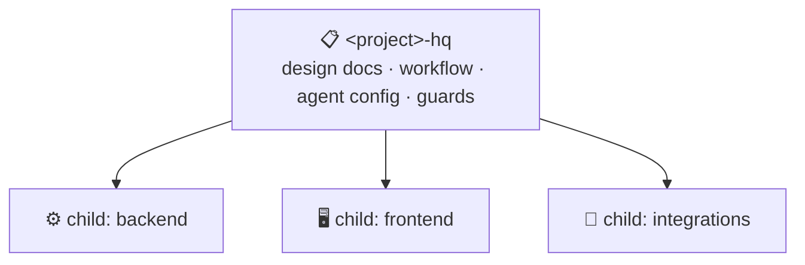

# 🤖 AXP Lab — AX & Product

> **We build AI automation products and deliver them to everyone at Tescom.**
>
> AXP stands for **AX & Product**: AI transformation (AX) that does not stop at experiments,
> but ships as products that people across the company use every day.

---

### 🎯 What We Do

* **Find the work worth automating.** Repetitive, document-heavy and knowledge-heavy work across
  Tescom's teams is where we look first.
* **Turn it into a product, not a script.** Every automation ships with an owner, a release
  history and an operating plan, so it keeps working after the demo.
* **Deploy it organization-wide.** A product is done when the teams that need it are using it,
  not when the code merges.

---

### 🧠 Built with Claude

All engineering in AXP Lab runs on **[Claude Code](https://claude.com/claude-code)**.

* **Claude implements; people decide.** Humans set direction, approve plans and own every
  release. Claude carries the work from plan to pull request.
* **Rules live in the repository.** Each project's `CLAUDE.md`, workflow documents and guard
  scripts tell the agent how that project works, so every session starts from the same rules.
* **Every change is reviewed.** Pull requests get an automatic Copilot review in addition to the
  agent's own checks and a human approval.

---

### 🏗️ Architecture — HQ + Child Repositories

Every project is one **HQ repository** that orchestrates several **child repositories**.

| Layer | Holds | Why |
| :--- | :--- | :--- |
| **HQ repository** | Design docs and decisions, the phase plan, the shared workflow, the agent's `CLAUDE.md` and skills, validation guards | One place where the project is planned, and one root that every Claude session starts from |
| **Child repositories** | Product code, tests, CI, deployment scripts | Each child keeps its own stack, history and release cycle |

* A Claude session **always starts in the HQ**, which then works in whichever child the task
  touches. The rules travel with the HQ, so children stay clean.
* **Work is organized into phases.** Each phase is planned in the HQ, carried out in the
  children, and archived in the HQ once it merges.
* The model is proven: it is how Tescom's collaboration platform is already being built.

---

### 🔄 Development Workflow

1. **Plan in the HQ.** The goal, design and acceptance criteria are written down before any code.
2. **Build in the child.** Feature branch → pull request → automated tests.
3. **Review.** Automatic Copilot review plus a human approval.
4. **Merge and archive.** The change lands through the merge queue and the phase record moves
   to the HQ archive.

---

### 🛠 Tech Stack

| Category | Technologies |
| :--- | :--- |
| **AI Engineering** |   |
| **Orchestration** |   |
| **Infrastructure** |  |

---

### 🤝 Join Our Journey

Just joined the organization?

1. Link your **tescomwireless.com** company email to your GitHub account.
2. Start with the **HQ repository** of the project you are joining and read its `CLAUDE.md`.
3. Open your Claude Code session from the HQ checkout, never from a child repository.

---
© 2026 Tescomwireless. All rights reserved.
